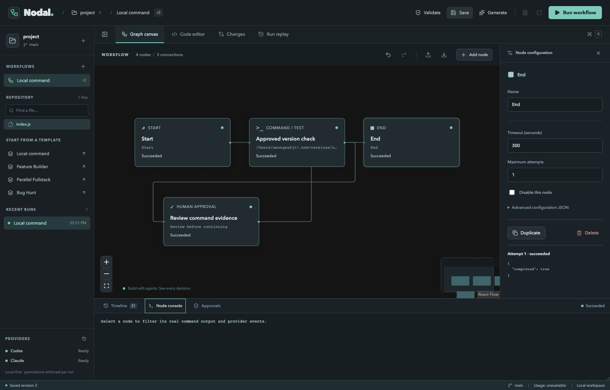

# Nodal

*Build with agents. See every decision.*

Nodal is a local desktop workspace for drawing and running coding workflows against Git repositories. It includes a React Flow editor, a real workflow scheduler, SQLite run history, Monaco file editing, isolated Git worktrees, approved command execution, and official Claude and Codex SDK adapters.

This is a working MVP with disclosed gaps, not the complete acceptance matrix in the supplied specification. Read [KNOWN_LIMITATIONS.md](KNOWN_LIMITATIONS.md) before using it with important repositories.



## Requirements

- Node.js **24 or later** (`node:sqlite` is required), pnpm 11, and Git.
- For the macOS desktop app: Rust/Cargo and Xcode Command Line Tools. The browser development app does not require Rust.
- Optional provider access through the official Codex or Claude login. A local login does not guarantee model entitlement or remaining usage.

## Launch

From the repository root:

```sh
pnpm install
pnpm dev
```

Open the **local URL printed by this command**, including its initial fragment. The fragment carries a random per-launch connection token; the app removes it from the address bar and keeps it in memory. Do not share that URL. Reloading browser mode requires reopening the printed launch URL.

For the native desktop app, with Rust/Cargo available on `PATH`:

```sh
pnpm desktop
```

To package the current platform:

```sh
pnpm desktop:build
```

On macOS the bundle is written to `apps/desktop/src-tauri/target/release/bundle/macos/Nodal.app`. It contains its own Node executable and the installed provider SDK dependencies. The bundle is large (approximately 745 MiB in the verified Apple Silicon build). It is a local unsigned build; signing, notarization, distribution installers, and other OS builds are not verified.

If a GUI launch cannot find Node in development, set `NODAL_NODE` to its absolute path. Release bundles use their packaged Node executable. Stop `pnpm dev` before `pnpm desktop`; both use frontend port 5173. This workspace also has a project-local Rust toolchain under `.nodal/tools`, which the desktop launcher detects automatically; it does not change your global toolchain.

## First run without provider access

```sh
pnpm example
```

This creates a new Git repository at `.nodal/example-project` with two intentionally failing tests. Supply a new directory as an argument to choose another location. Existing directories are never overwritten.

1. Open that repository in Nodal. Browser mode accepts a full path; the native app also has a folder picker.
2. Choose **Local command**, select its command node, and inspect the executable and arguments.
3. Save the workflow, then run it. Open **Approvals** and review the command and host-execution warning before approving.
4. Inspect the actual version output in **Node console**, and the completed attempt in **Run replay**.
5. Open `add.js`, change subtraction to addition, and save. **Changes** shows the Git diff. File writes compare the original disk hash so external changes cannot be silently overwritten.

Commands and coding attempts execute from committed Git snapshots in separate worktrees. Unsaved buffers and uncommitted main-working-tree changes are not included. Commit reviewed manual changes in your repository before using them as a workflow's base.

Run an automated genuine test-fix loop without paid provider access:

```sh
pnpm demo:quality-loop
```

This explicitly labeled deterministic fixture runs real Node tests, records a failing attempt, retries through a bounded quality gate, repairs a real file, and records passing tests. It does not present fixture behavior as a real coding agent.

## Coding workflows

The editable **Feature Builder**, **Parallel Fullstack**, and **Bug Hunt** templates assign real Claude/Codex nodes. Configure instructions for your task, check every command, and validate before running. Models default to each SDK's configured model; the inspector accepts an explicit model ID.

Agent permissions begin read-only. Scoped edit authorizes changes inside the attempt worktree; Codex's workspace-write sandbox also permits sandboxed commands. Every provider request asks approval before sending task and repository context. Every command attempt asks approval regardless of graph-supplied permission flags.

A quality gate evaluates structured results such as a test command's actual exit code. A failing machine check cannot be overridden by a reviewer opinion. Every retry retains its own attempt. Parallel nodes use independent branches, and an explicit Merge node reconciles them into another isolated integration worktree.

To apply work to the chosen repository, finish or stop the run, open **Changes**, refresh, review the branch diff, then choose **Apply reviewed changes**. The runtime checks both reviewed commits and requires a clean destination. Conflicts are reported and aborted; attempt branches remain available. Configure and approve integration tests after reconciliation; tests are not automatically run after the separate main-worktree Apply action.

Pause blocks new scheduling at safe boundaries. Stop aborts active sessions/processes and prevents further nodes from starting. Worktrees survive cancellation. Historical replay reads saved events and never executes them. Re-run creates a new run from the saved workflow against the repository's current committed HEAD, with fresh permission requests.

**Generate** uses Claude in tool-free mode to propose schema-validated graph JSON. Generation sends your prompt and current graph configuration to the provider. Preview the nodes, limits, commands, and permissions before applying. Invalid output receives at most one correction attempt. Codex graph planning is unavailable because this SDK cannot enforce a tool-free turn.

## Provider authentication and verification

Use official authentication outside Nodal:

```sh
codex login
claude auth login
pnpm verify:provider codex
pnpm verify:provider claude
```

Availability checks use installed native binaries and local login status without a model request. Nodal does not request passwords, scrape browser sessions, provision keys, or save credentials in SQLite or renderer storage. See [docs/PROVIDERS.md](docs/PROVIDERS.md) for policy details.

Explicit live verification, which may consume provider usage:

```sh
pnpm verify:provider codex --live /absolute/path/to/repository
pnpm verify:provider claude --live /absolute/path/to/repository
```

Both adapters were verified with genuine streamed marker turns in this environment. That confirms the installed SDK/authentication path, not broad provider reliability or sandbox certification. Missing dollar telemetry remains unavailable.

## Local data and security

The default data directory is `~/.local/share/nodal` on all platforms. Set `NODAL_DATA_DIR` to choose another location. It contains `nodal.sqlite` (WAL), bounded diff artifacts under `artifacts/`, preserved attempt directories under `worktrees/`, and an empty planning scratch directory. Workflow history includes prompts, outputs, source references, and potentially private code. Protect this directory like a repository. Back it up only while the app is stopped, or use a proper SQLite online backup.

**Local-first does not mean sandboxed.** The approved command runner executes with your OS user privileges, including host filesystem and network access. It uses argument arrays and process-group cancellation, but is not a container, microVM, network policy, or resource-quota boundary. Use trusted code only. Nodal never pushes, publishes, resets, cleans, or deletes branches automatically.

The renderer has no direct shell/filesystem Tauri capability. The sidecar binds only `127.0.0.1`, validates Host and Origin, requires a random token, and validates request bodies. File access rejects traversal, symlink components, and hard links. Automatic task commits reject known credential paths. Common secrets are redacted from events, but no heuristic can detect every secret in arbitrary code.

## Development and tests

```sh
pnpm lint
pnpm typecheck
pnpm test
pnpm build
pnpm verify:bundle
pnpm test:e2e
pnpm demo:quality-loop
```

`test:e2e` uses the gstack browse skill, as required by the workspace instructions; set `NODAL_BROWSE_BIN` when it is installed elsewhere. It opens a separate production preview on loopback port 5174 and a temporary Git repository. See [docs/TESTING.md](docs/TESTING.md) for coverage and verification boundaries, [docs/ARCHITECTURE.md](docs/ARCHITECTURE.md) for package/process design, and [docs/OPERATOR_GUIDE.md](docs/OPERATOR_GUIDE.md) for recovery and troubleshooting.

The source remains organized as `apps/desktop`, `packages/{shared,core,runtime,persistence,workspace,providers}`, `examples`, `scripts`, and `docs`. The original supplied product specification is preserved in `FORGE_CODEX_BUILD_SPEC.md`; all application code, data paths, UI, and new documentation use Nodal.
